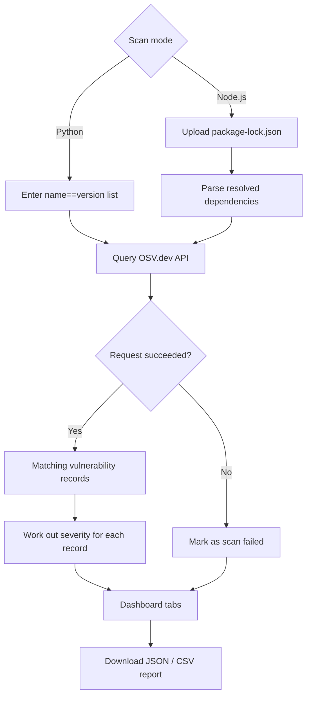

# Dependency Risk Radar

Identify risky dependencies. Understand why they are risky. Know what to fix.

Dependency Risk Radar is a Streamlit app that checks Python and npm dependencies against the [OSV.dev](https://osv.dev/) vulnerability database. You give it a list of packages or a `package-lock.json`, and it shows which dependencies have known vulnerabilities, how severe they are, and lets you export the results.


## What it does

- Scans Python packages (PyPI). Enter one `name==version` per line.
- Scans npm projects. Upload a `package-lock.json` (lockfile v2 or v3) and every resolved dependency, including transitive ones, is checked.
- Works out a severity for each finding (Critical, High, Medium, Low or Unknown) from the data OSV returns.
- Shows the results in four tabs: Overview, Vulnerability Findings, Dependencies and Reports.
- Lets you filter findings by severity and search them, and filter dependencies by scan status.
- Exports a JSON or CSV report with severity, CVSS score and the findings sorted by severity.
- Marks packages that could not be scanned as failed instead of treating them as safe.

### Still to do

- Dependency graph
- npm Registry checks (deprecation, publish history, license)
- Upgrade and fix suggestions
- `package.json` support

## How it works



### How severity is decided

Severity is never guessed. For each OSV record, the app checks in this order:

1. A CVSS v3 or v4 vector in the record. The score is calculated with the [`cvss`](https://pypi.org/project/cvss/) library and mapped to Low, Medium, High or Critical.
2. A severity label provided by the database (for example a GitHub advisory label).
3. Otherwise the severity is shown as Unknown.

## Tech stack

Python, Streamlit, pandas, `requests`, `cvss`, and the OSV.dev API.

## Project structure

```text
DepenDency-Risk-RaDar/
├── app.py                 # Streamlit app: pages, scan workflow, dashboard
├── node_scanner.py        # package-lock.json parser
├── osv_client.py          # OSV.dev API client
├── severity_analyzer.py   # CVSS parsing and severity classification
├── report_generator.py    # Summary metrics, prioritization, JSON and CSV reports
├── requirements.txt
└── tests/
    ├── test_node_scanner.py
    ├── test_osv_client.py
    ├── test_report_generator.py
    └── test_severity_analyzer.py
```

## Running it locally

You need Python 3.10 or newer.

```bash
git clone https://github.com/Nandanpatgar/DepenDency-Risk-RaDar.git
cd DepenDency-Risk-RaDar

python -m venv .venv
source .venv/bin/activate      # on Windows: .venv\Scripts\activate

pip install -r requirements.txt
streamlit run app.py
```

The app opens in your browser, usually at `http://localhost:8501`.

To try it quickly, paste this into the Python scanner:

```text
requests==2.19.0
flask==0.12.2
```

### Tests

```bash
pip install pytest
python -m pytest
```

Run this from the repository root. `tests/test_osv_client.py` is a manual script that calls the live OSV API rather than a pytest test, so pytest skips it.

## Reading the results

- Vulnerable: at least one OSV record matches that package version.
- No matching records: OSV returned nothing for that version.
- Failed: the lookup did not complete, so the package's status is unknown.

The counts are OSV records, not necessarily separate security issues, since one issue can have several records. No matching records does not prove a package is safe. Results depend on what OSV.dev covers and how recent its data is.

## Security notes

- Uploaded lockfiles are read as JSON only. No project code or install scripts are run.
- API and network errors are shown in the results, not hidden.

## Team

Built by Clutch Crew for BYTE RACE 2026.
