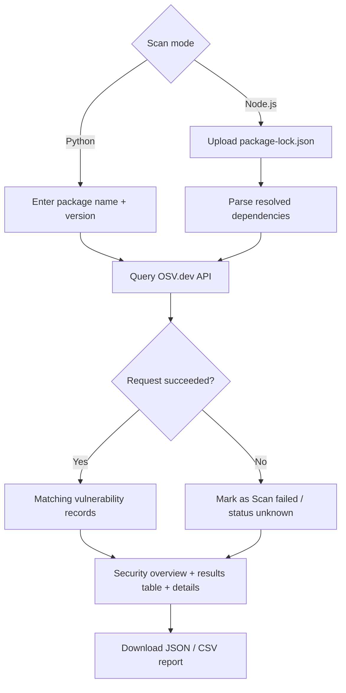

# Dependency Risk Radar 

**Identify risky dependencies. Understand why they are risky. Know what to fix.**

Dependency Risk Radar is a Streamlit app that checks software dependencies against the [OSV.dev](https://osv.dev/) vulnerability database. Scan a single Python package, or upload an npm `package-lock.json`, review a security overview, and download the results as JSON or CSV.


## ✨ Features

**Available now**

- **Python package scan:** check one PyPI package and exact version
- **Node.js project scan:** upload a `package-lock.json` (lockfile v2 and v3) and scan every resolved npm dependency, including transitive ones
- **Security overview dashboard:** total dependencies, successfully scanned, failed scans, packages with findings and vulnerability records
- **Dependency results table:** package, version, scan status and record count at a glance
- **Vulnerability details:** ID, aliases (e.g. CVE), summary, description and reference links for each match
- **Downloadable reports:** export results as **JSON** or **CSV**
- **Honest failures:** packages that couldn't be scanned are marked "Scan failed", never shown as safe

**Planned**

- Severity-based risk ranking
- Dependency graph visualization
- Package health checks (deprecation, publish history, license) via the npm Registry
- Upgrade and remediation suggestions
- `package.json` support

## ⚙️ How It Works



##  Tech Stack

Python · [Streamlit](https://streamlit.io/) · `requests` · [OSV.dev API](https://osv.dev/)

## Project Structure

```text
DepenDency-Risk-RaDar/
├── app.py                # Streamlit UI, scan workflow and dashboard
├── node_scanner.py       # package-lock.json parser
├── osv_client.py         # OSV.dev API client
├── report_generator.py   # Summary metrics, JSON and CSV reports
├── requirements.txt
└── tests/
    ├── test_node_scanner.py
    ├── test_osv_client.py
    └── test_report_generator.py
```

##  Getting Started

Requires Python 3.10+ and Git.

```bash
git clone https://github.com/Nandanpatgar/DepenDency-Risk-RaDar.git
cd DepenDency-Risk-RaDar

python -m venv .venv
source .venv/bin/activate      # Windows: .venv\Scripts\activate

pip install -r requirements.txt
streamlit run app.py
```

Streamlit opens the app in your browser (usually `http://localhost:8501`).

### Try it

- **Python scan:** enter `requests` with an older version such as `2.19.0`
- **Node.js scan:** upload any project's `package-lock.json`

### Run the tests

```bash
pip install pytest
python -m pytest
```

Run this from the repository root. `test_osv_client.py` may need internet access if it calls the live OSV API.

##  Reading the Results

- 🔴 **Vulnerable:** one or more OSV records match this package version
- 🟢 **No matching records:** OSV returned nothing for this version
- ⚠️ **Scan failed:** the lookup failed, so the package's status is unknown

Counts are matching OSV records, not necessarily unique security issues, and severity is not inferred. A clean result does not guarantee a package is secure. Findings depend on OSV.dev's coverage and freshness.

### Report formats

| Format | Contents |
|---|---|
| **JSON** | Project name, ecosystem, generation time (UTC), summary metrics, and per-dependency vulnerability IDs, summaries, aliases and reference URLs |
| **CSV** | One row per dependency: package, version, scan status, record count and vulnerability IDs |

## 🔐 Security

- Uploaded lockfiles are parsed as JSON data; no project code or install scripts are ever executed.
- Network or API failures are reported clearly instead of being hidden.

## 👥 Team

Built by **Clutch Crew** for **BYTE RACE 2026**.
