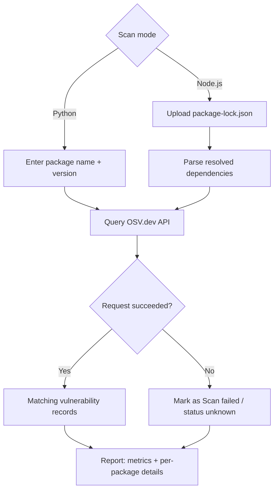

# Dependency Risk Radar 🛡️

**Identify risky dependencies. Understand why they are risky. Know what to fix.**

Dependency Risk Radar is a Streamlit app that checks software dependencies against the [OSV.dev](https://osv.dev/) vulnerability database. Scan a single Python package, or upload an npm `package-lock.json` and get a full report of every resolved dependency.


## ✨ Features

**Available now**

- **Python package scan:** check one PyPI package and version
- **Node.js project scan:** upload a `package-lock.json` (lockfile v2 and v3) and scan every resolved npm dependency
- **Vulnerability details:** ID, aliases (e.g. CVE), summary, details and reference links for each match
- **Scan report:** totals for dependencies, successfully scanned, packages with findings and vulnerability records
- **Honest failures:** packages that couldn't be scanned are marked "Scan failed" and listed with the error, never shown as safe

**Planned**

- Severity-based risk ranking
- Dependency graph visualization
- Package health checks (deprecation, publish history, license) via the npm Registry
- Upgrade and remediation suggestions
- `package.json` support and exportable reports

## ⚙️ How It Works



## 🧰 Tech Stack

Python · [Streamlit](https://streamlit.io/) · `requests` · [OSV.dev API](https://osv.dev/)

## 🏗️ Project Structure

```text
DepenDency-Risk-RaDar/
├── app.py              # Streamlit UI and scan workflow
├── node_scanner.py     # package-lock.json parser
├── osv_client.py       # OSV.dev API client
├── requirements.txt
└── tests/
```

## 🚀 Getting Started

Requires Python 3.10+ and Git.

```bash
git clone https://github.com/Nandanpatgar/DepenDency-Risk-RaDar.git
cd DepenDency-Risk-RaDar

python -m venv venv
source venv/bin/activate      # Windows: venv\Scripts\activate

pip install -r requirements.txt
streamlit run app.py
```

Streamlit opens the app in your browser (usually `http://localhost:8501`).

## 📊 Reading the Results

- 🔴 **Vulnerable:** one or more OSV records match this package version
- 🟢 **No matching records:** OSV returned nothing for this version
- ⚠️ **Scan failed:** the lookup failed, so the package's status is unknown

The counts are matching OSV records, not necessarily unique security issues, and severity is not inferred. A clean result does not guarantee a package is secure. Findings depend on OSV.dev's coverage and freshness.

## 🔐 Security

- Uploaded lockfiles are parsed as JSON data; no project code or install scripts are ever executed.
- Network or API failures are reported clearly instead of being hidden.

## 👥 Team

Built by **Clutch Crew** for **BYTE RACE 2026**.
