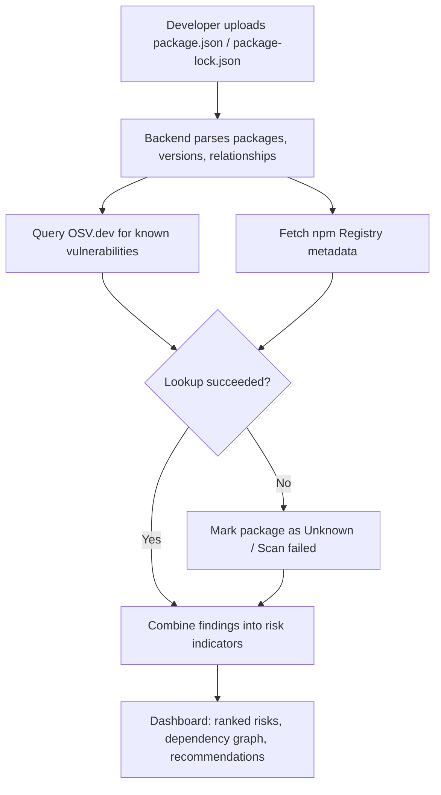

# Dependency Risk Radar 🛡️

**Identify risky dependencies. Understand why they are risky. Know what to fix.**

Dependency Risk Radar analyzes a Node.js project's dependencies, checks them for known vulnerabilities, and shows prioritized, explainable results in an interactive dashboard.

<!--  -->

## ✨ Features

- **Dependency analysis:** parses `package.json` / `package-lock.json`
- **Vulnerability detection:** checks versions against [OSV.dev](https://osv.dev/)
- **Risk prioritization:** ranked results, with the reasons shown, not just a score
- **Dependency graph:** interactive view of package relationships
- **Package health:** deprecation, publish history and license info from the [npm Registry](https://registry.npmjs.org/)
- **Recommendations:** safer version upgrades where data is available

> List a feature as done only once it works in the current version.

## ⚙️ How It Works



## 🧰 Tech Stack

React, TypeScript, Vite (frontend) · Node.js, Express, TypeScript (backend) · OSV.dev and npm Registry (data) · React Flow (graph, if used)

## 🚀 Getting Started

Requires Node.js, npm and Git.

```bash
git clone <YOUR_GITHUB_REPOSITORY_URL>
cd dependency-risk-radar

# Terminal 1: backend
cd backend && npm install && npm run dev

# Terminal 2: frontend
cd frontend && npm install && npm run dev
```

Open the local URL shown by the frontend dev server.

## 📊 Reading the Results

- 🔴 **Vulnerable:** a known vulnerability matches this version
- 🟢 **No known vulnerability found:** the lookup found no match
- ⚪ **Unknown / Scan failed:** couldn't be verified (missing data or API failure)

A clean result is not a guarantee of security. Findings depend on the coverage and freshness of OSV.dev and the npm Registry.

## 🔐 Security

- Uploaded files are parsed as data; project code and install scripts are never executed.
- API failures and incomplete data are reported clearly.
- Risk scores help prioritize; they are not guarantees.

## 🛣️ Future Work

Abandonment detection · license compatibility checks · better upgrade suggestions · exportable reports · more vulnerability sources

## 👥 Team

Built by **Clutch Crew** for **BYTE RACE 2026**.

